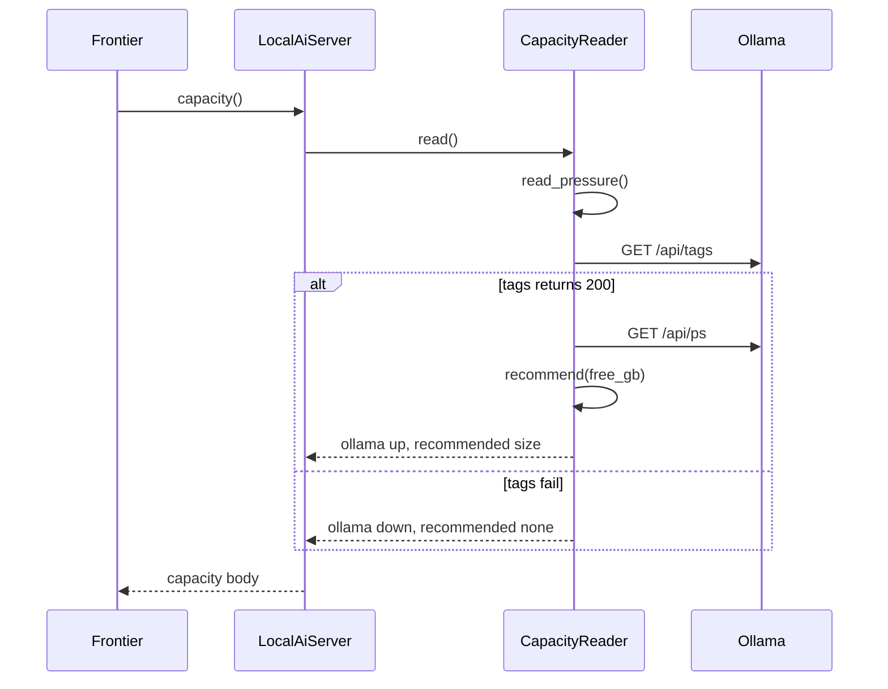
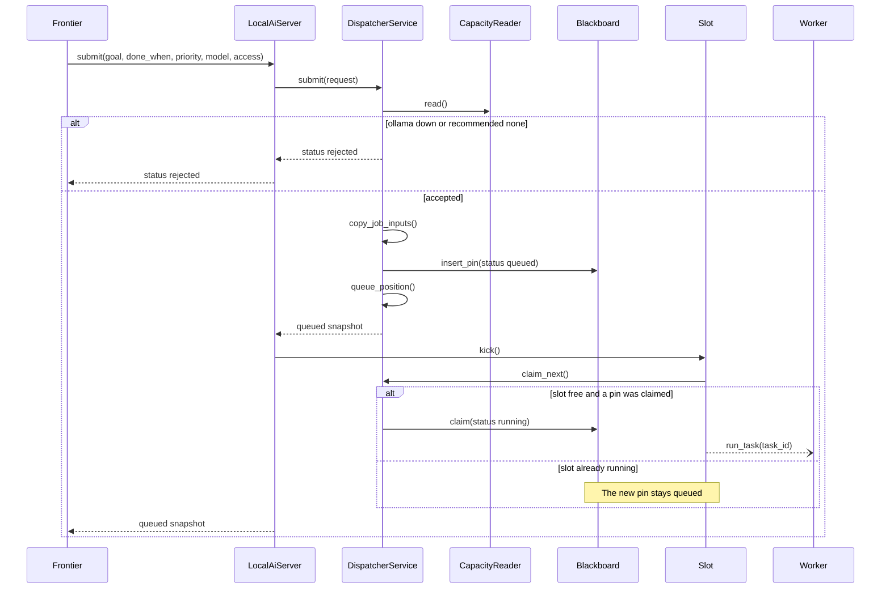
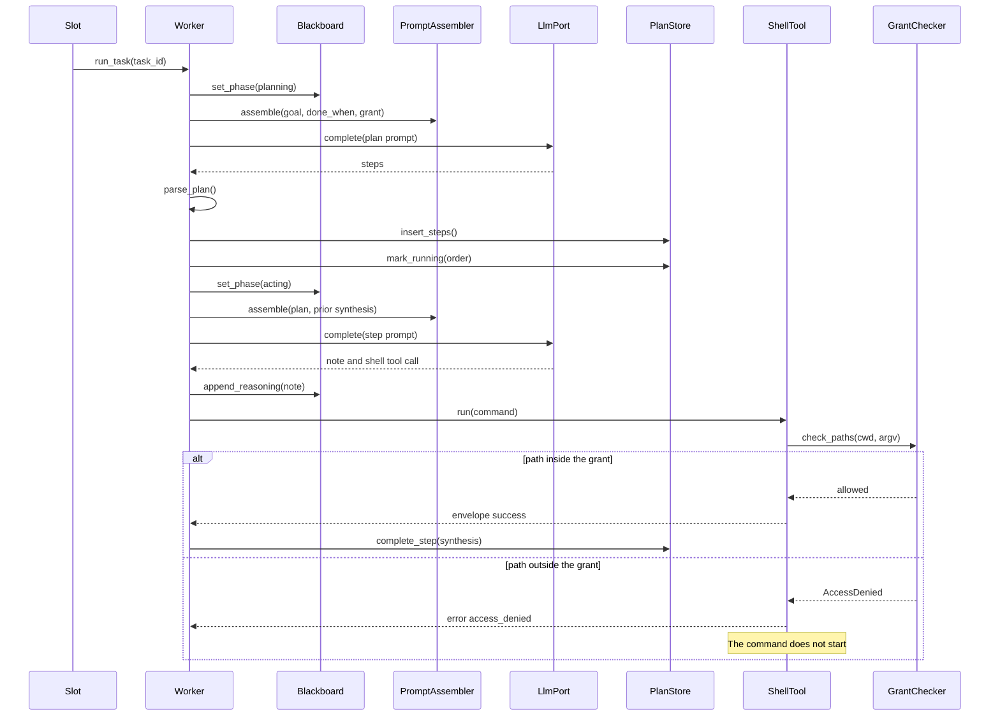
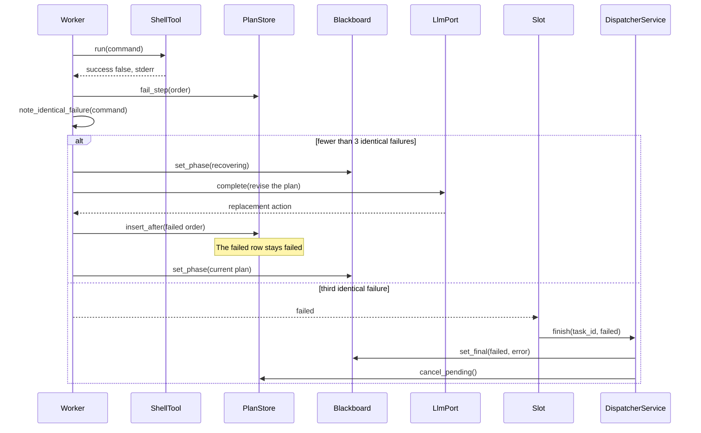
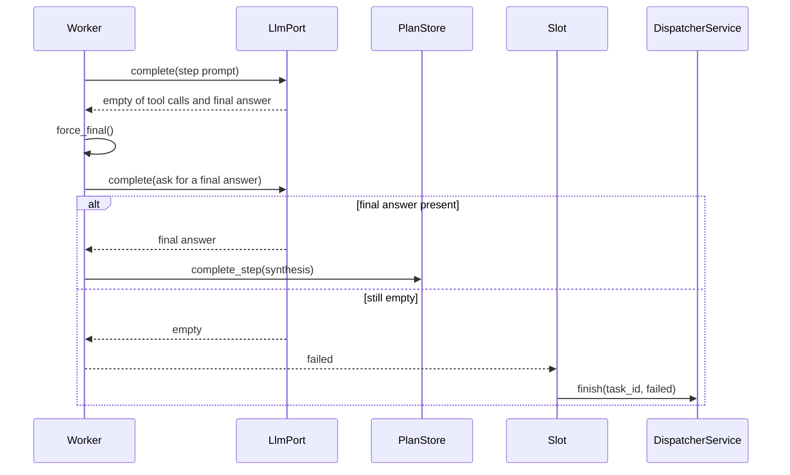
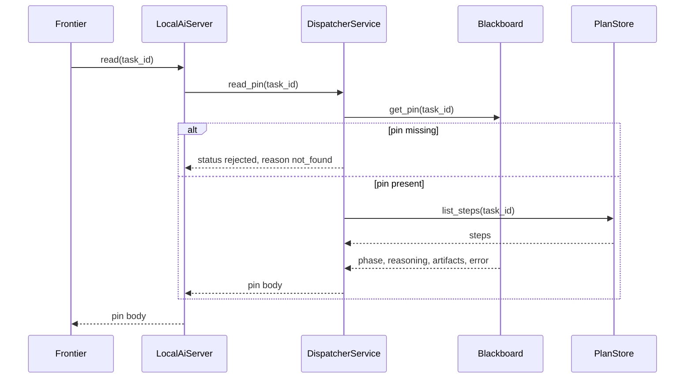
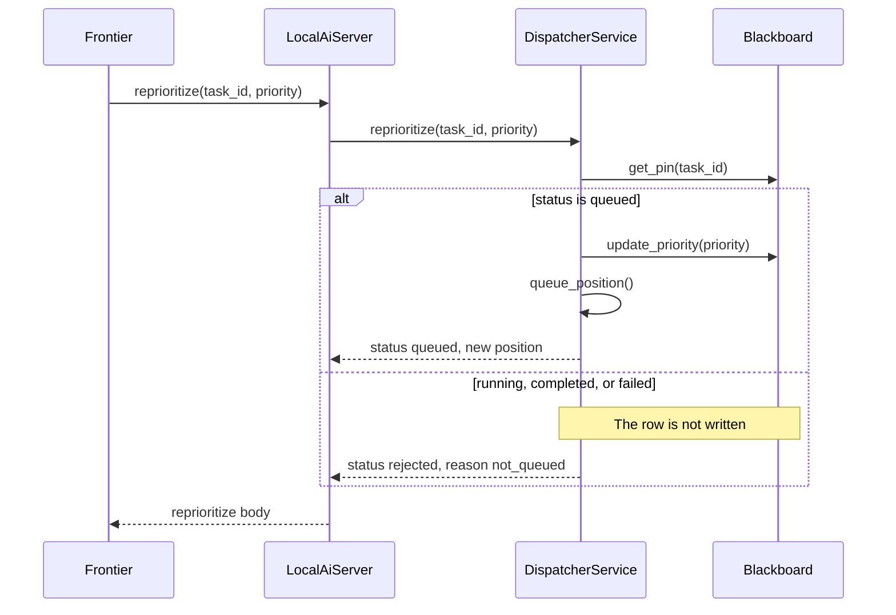
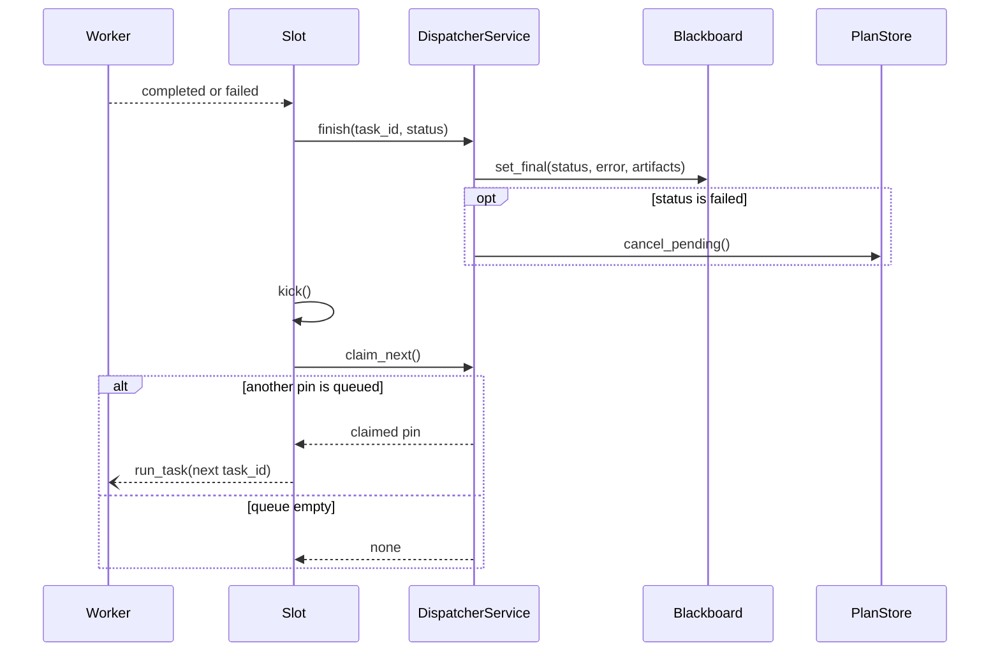
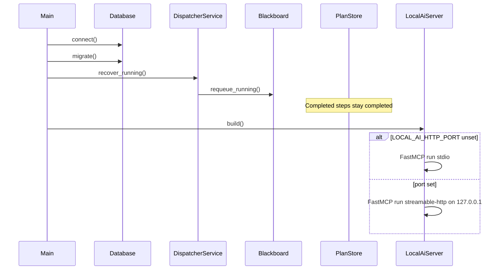

# Local AI: System Architecture Overview

## Executive Summary

Local AI is a dispatcher that lets a frontier model (Cursor, Claude Desktop, or ChatGPT) hand mechanical work to a local Qwen model served by Ollama. The frontier model never calls a model and never receives a shell. It talks only to the dispatcher. The dispatcher pins each task on a blackboard, keeps a priority queue, and runs one local worker at a time. That worker is an agent: it plans, runs shell commands inside a per-job access grant, emits reasoning while it works, and recovers from a failed step by revising the plan.

**Key architectural decisions**

- One MCP server, the dispatcher, is the only interface a frontier model sees.
- One worker runs at a time. Waiting tasks stay pinned on the blackboard until the dispatcher hands one of them over.
- The worker is a Junior Edda Pattern 4 agent (scenario SC-01) served as a queued job (Part 3.2). Each step is a model call, followed by a shell action. A failed step revises the remaining plan.
- LiteLLM is the model port to Ollama. The agent loop, the queue, the blackboard, and the shell grant are first-party.
- Each job carries an access grant: a private job folder (default), a list of folders, or the home directory.
- The frontier model chooses 8B, 14B, or 24B after reading `capacity`. The dispatcher records that choice on the pin and uses it when it starts the worker.

Reference: Junior Edda artifact **AI Agent Reference Architecture** (playbook 3, artifact 56), Parts 1–4. This document selects a subset of those capabilities. It does not import LangChain, CrewAI, or AutoGen.

## System Architecture

```text
Frontier model (Cursor / Claude Desktop / ChatGPT)
        │  MCP: capacity, submit, read, reprioritize
        ▼
Dispatcher
        │  pins and reads
        ▼
SQLite  ── queue (priority 1..100) + blackboard pins + plan steps
        │  one running worker
        ▼
Worker agent (Qwen via LiteLLM → Ollama)
        │  shell, confined to the job's access grant
        ▼
Job directory, named folders, or ~
        pandoc, weasyprint, python3, curl, and the rest of the PATH
```

The dispatcher accepts a task, writes its pin, and places it in the queue. When no worker is running, the dispatcher takes the head of the queue and starts one worker with that pin. While the worker runs, the dispatcher appends the worker's reasoning to the pin. When the worker stops, the dispatcher writes the final status on the same pin.

## 1. Application Blocks

### Bounded contexts

| Package | Responsibility |
|---------|----------------|
| `dispatcher/` | MCP tools, queue order, single-worker slot, pin updates |
| `blackboard/` | Pin schema, reasoning append, final status |
| `plan/` | Durable steps and their state machine |
| `worker/` | Agent loop for the one running task |
| `llm/` | LiteLLM adapter over Ollama |
| `tools/` | Shell tool and access-grant enforcement |
| `prompt/` | Task layer, shell brief, grant layer |
| `capacity/` | Memory, pressure, loaded model, size recommendation |

### Module dependency rules

```text
dispatcher → blackboard, plan, worker, capacity
worker     → llm, tools, prompt, plan, blackboard
tools      → (no dispatcher, no llm)
llm        → LiteLLM only
blackboard → SQLite
plan       → SQLite
```

`tools/` does not import the agent loop. `llm/` does not import the dispatcher. The loop calls tools. It does not own queue policy.

### Foundational architectural pattern

- **Chosen**: Dispatcher plus a single queued agent worker.
- **Rationale**: The frontier model decides what to delegate and which model size to use. The local model does the work, with a plan and a shell, and reports through the blackboard. Queue order is priority. The dispatcher runs one worker, then the next pin.

### UI

No product UI. Operators inspect pins with `read` and the SQLite file. A later status page can render the same pins.

## 2. Integration & API Design

### API style

- **Chosen**: MCP tools on the dispatcher.
- **Rationale**: Cursor, Claude Desktop, and ChatGPT already speak MCP. One tool list is the contract.

### Versioning

- **Chosen**: Tool names stay stable. A breaking argument change adds a new tool name. The SQLite file stores `schema_version`.

### Contract approach

- **Chosen**: Each tool has a documented request and a documented response in this file. Callers check response fields. An MCP success frame can still carry `status: "rejected"`.

### External integrations

| System | Role |
|--------|------|
| Ollama | Serves Qwen. The worker reaches it through LiteLLM. |
| LiteLLM | OpenAI-compatible completion and tool calls against `OLLAMA_HOST`. |
| pandoc, weasyprint, python3, curl | Binaries the worker may invoke through the shell. They are not separate MCP servers. |

### Inter-service communication

- **Chosen**: In-process calls from the dispatcher to the worker slot. The frontier model polls `read`.
- **Rationale**: One machine, one worker. A broker is unnecessary until a second machine runs workers.

### Transports

| Client | Transport |
|--------|-----------|
| Cursor, Claude Desktop | stdio |
| ChatGPT | streamable HTTP on a localhost port |

Both transports call the same dispatcher methods.

### Tool inventory

| Tool | Write? | Effect |
|------|--------|--------|
| `capacity` | no | Current machine load and a model-size recommendation |
| `submit` | yes | Pin a task and enqueue it |
| `read` | no | Return one pin, including live reasoning |
| `reprioritize` | yes | Change priority of a queued pin |

Stdout of the stdio server stays empty. Logs go to `logs/app.log` and stderr.

## 3. Code Organization

```text
local_ai/
  dispatcher/     MCP handlers and the single-worker slot
  blackboard/     pin read/write
  plan/           steps
  worker/         agent loop
  llm/            LiteLLM → Ollama
  tools/          shell + grant check
  prompt/         three prompt layers
  capacity/       memory and Ollama /api/ps
  db/             SQLite schema and migrations
logs/app.log
data/local-ai.sqlite
data/jobs/<task_id>/
```

Public functions stay short. Shell grant checks, prompt assembly, and step transitions live in helpers.

## 4. Data Architecture

SQLite file `data/local-ai.sqlite`. One connection policy: the dispatcher process is the only writer.

### Task pin

| Column | Meaning |
|--------|---------|
| `id` | UUID |
| `priority` | Integer 1 (first) through 100 (last) |
| `status` | `queued`, `running`, `completed`, `failed` |
| `model` | `qwen-8b`, `qwen-14b`, or `qwen-24b` |
| `goal` | What the worker must achieve |
| `done_when` | Observable completion condition |
| `access_json` | Grant object below |
| `phase` | Latest phase word from the worker |
| `current_plan` | Short text of the live plan |
| `reasoning` | Append-only notes, truncated to the board cap |
| `artifacts_json` | Paths the worker declared |
| `error` | Last failure summary |
| `created_at` | Enqueue time, used as the tie-break |
| `started_at`, `finished_at` | Dispatch and stop times |

Queue order for `status = queued`: `priority ASC`, then `created_at ASC`.

A running pin is not reordered. `reprioritize` applies to `queued` pins.

### Plan steps

| Column | Meaning |
|--------|---------|
| `task_id` | Parent pin |
| `order` | Execution order |
| `action` | What this step is for, in one sentence |
| `status` | `pending`, `running`, `completed`, `failed`, `waiting_retry` |
| `result_json` | Tool envelope or parsed output |
| `error` | Why the step failed. Empty when it has not failed. `read` returns this with the step |
| `llm_synthesis` | What the next step must know |

Completed steps stay completed if the task resumes.

### Access grant

```json
{ "mode": "job" }
```

```json
{ "mode": "paths", "paths": ["/Users/denispetelin/books/draft"] }
```

```json
{ "mode": "home" }
```

`job` is the default when `access` is omitted. The dispatcher creates `data/jobs/<task_id>/` and copies or links the declared input files into it when the grant is `job`. `paths` allows those directories and the job directory. `home` allows the user home directory.

### Blackboard keys on the pin

Fixed keys, durability tier B (the row survives a process restart). Reasoning cap: 32_000 characters. When a new note would exceed the cap, the dispatcher drops the oldest note and keeps a marker that earlier notes were truncated. A note that fails to parse is discarded. The previous reasoning text stays.

| Key | Role |
|-----|------|
| `phase` | `queued`, `planning`, `acting`, `recovering`, `completed`, `failed` |
| `current_plan` | Ordered steps in one readable block |
| `reasoning` | Intermediary notes, newest last |
| `artifacts` | Output paths |
| `error` | Set when status becomes `failed` |
| `final_status` | `completed` or `failed`, written by the dispatcher when the worker slot is released |

Each shell command appends one reasoning note: the command, the exit, and a short excerpt of stdout or stderr. `current_plan` is rewritten when a step completes or fails, so `read` shows the same status as the step row, and that step's `error`.

`completed` requires every file named in `done_when` (`.md`, `.txt`, `.py`, `.pdf`) to exist in the job directory. A text file that is empty or only whitespace does not count. A missing or blank file fails the pin. `error` and a reasoning note name that file.

## 5. Test Strategy

Pytest. Tests live under `tests/unit/`, `tests/integration/`, and `tests/api/`.

| Proof | What it shows |
|-------|----------------|
| Queue order | Priority 1 runs before priority 100. Equal priority keeps `created_at` order. |
| Single slot | A second queued task stays `queued` while the first is `running`. |
| Grant | A shell path outside the grant returns an error envelope. `mode: home` allows a path under `~`. |
| Hybrid worker | A step that needs a tool calls the model, then the shell. The test uses ScriptedLLM (CAP-004). |
| Recovery | A failed shell marks the step `failed`, the scripted model revises the plan, and a later step completes. |
| Blackboard retain | A malformed reasoning chunk leaves the previous pin text in place. |
| Failure is visible | When the worker stops with an error, `read` returns `status: failed` and `error`. |
| Contracts | `capacity`, `submit`, `read`, and `reprioritize` match the JSON examples in this file. |

The integration suite uses a real SQLite file and a real shell in a temporary directory. Only the LLM is scripted.

## 6. Performance & Scalability

One worker occupies the dispatcher. `capacity` exists so the caller can pick a model that fits the machine before `submit`. The dispatcher reports free memory, memory pressure, the model Ollama currently has loaded, and a recommendation. It then uses the model named on the pin.

This host has 64 GB of memory. The recommendation table, until measured on a real run, is:

| Free memory after the loaded model | Recommendation |
|------------------------------------|----------------|
| at least 20 GB | `qwen-24b` |
| at least 12 GB | `qwen-14b` |
| at least 8 GB | `qwen-8b` |
| below 8 GB | `none` — `submit` may still name a model; the dispatcher records the caller's choice |

Switching size happens when a new task starts, because that is when the dispatcher loads the pin's model.

## 7. Error Handling & Resilience

| Situation | Behavior |
|-----------|----------|
| Ollama is down at startup | The dispatcher stays up. `capacity.ollama` is `down`. `submit` is rejected with `status: rejected` and `reason: ollama_down`. |
| Shell exits non-zero | The step becomes `failed`. The agent receives the stderr in the tool envelope and may append a replacement step (plan adapt). |
| The agent repeats the same failing command | After 3 identical failures on one step, the dispatcher sets the pin to `failed` and releases the slot. |
| Process crash while `running` | On startup the dispatcher sets that pin back to `queued` and clears `started_at`, leaving completed steps completed. |
| Model returns no tool call and no final answer | The loop asks once for a final answer. If that is empty, the pin becomes `failed`. |
| `reprioritize` on a running or finished pin | Response `status: rejected`, pin unchanged. |

Tool errors stay inside the tool envelope. They do not raise out of the agent loop.

## 8. Infrastructure

Local macOS process. Ollama listens on `127.0.0.1:11434`. The dispatcher is a Python process the operator starts. Job files live under `data/jobs/`. No container is required for the first running version.

## 9. CI/CD Pipeline

Not yet decided. Local `pytest` is the gate until a pipeline exists.

## 10. Release & Rollback

Not yet decided. The SQLite `schema_version` is the rollback boundary for data. A bad dispatcher build is replaced by starting the previous process against the same SQLite file.

## 11. Observability

`logs/app.log` rotates on each dispatcher start. Every MCP call and every step transition logs at INFO:

```text
dispatcher.submit | entry | task_id=… priority=40 model=qwen-14b grant=paths
worker.step | acting | task_id=… step=2 tool=shell
dispatcher.finish | exit | task_id=… status=completed artifacts=2
```

The same `task_id` is the correlation id on every line for that job. Reasoning text is on the pin. Log lines carry step order and status, not the full shell transcript. Shell transcripts live in `data/jobs/<task_id>/shell.log`.

## 12. Config & Secrets

| Variable | Purpose |
|----------|---------|
| `OLLAMA_HOST` | Default `http://127.0.0.1:11434` |
| `LOCAL_AI_MODEL_8B` | Ollama tag for `qwen-8b` |
| `LOCAL_AI_MODEL_14B` | Ollama tag for `qwen-14b` |
| `LOCAL_AI_MODEL_24B` | Ollama tag for `qwen-24b` |
| `LOCAL_AI_DB` | SQLite path, default `data/local-ai.sqlite` |
| `LOCAL_AI_JOBS` | Job root, default `data/jobs` |
| `LOCAL_AI_HTTP_PORT` | Set only for the ChatGPT HTTP transport |

No cloud API key. Ollama is local.

## 13. Security

The shell is the worker's only tool. Before a command runs, the dispatcher resolves every path argument and the working directory against the grant. A path outside the grant returns `error: access_denied` and does not execute. `mode: home` is an explicit grant on that job, stored on the pin so a later `read` shows what the worker was allowed to touch.

The MCP server binds stdio for local IDE clients. The HTTP transport binds `127.0.0.1` only.

## 14. Backup & Recovery

Copy `data/local-ai.sqlite` and `data/jobs/`. Restoring those two restores the queue, the pins, and the artifacts. A pin left `running` is returned to `queued` on the next start, as in section 7.

## 15. Developer Experience

```bash
ollama serve
pytest tests/
python -m local_ai.dispatcher
```

Cursor and Claude Desktop launch the same module over stdio. A second process with `LOCAL_AI_HTTP_PORT` serves ChatGPT.

## 16. Documentation Strategy

This file is the contract. Tool JSON examples below are the fixtures the contract tests load. When a tool field changes, update the example and the test in the same change.

## 17. AI Agent Architecture

### Infra layer

| Setting | Value |
|---------|-------|
| LLM provider | Ollama through LiteLLM |
| Ollama host | `http://127.0.0.1:11434` |
| Model tags | `LOCAL_AI_MODEL_8B`, `LOCAL_AI_MODEL_14B`, `LOCAL_AI_MODEL_24B` |
| API key storage | None for the local model |
| Broker | None. The dispatcher process holds the single worker slot |
| LLM readiness | `GET {OLLAMA_HOST}/api/tags` from `capacity`. A non-200 sets `ollama: down` |

### Vector tier

Not selected. Job inputs are files in the grant. The worker reads them with the shell.

### Design pattern and scenario

| SC-ID | Pattern | Name | Selected? | Rationale |
|-------|---------|------|-----------|-----------|
| SC-01 | 4 | Conversational planner | Yes | The worker receives a goal, writes a plan, and executes steps with the model in the loop |
| SC-02 | 2 | Field extractor | No | Summaries are ordinary plan steps, not a separate extractor product |
| SC-03 | 7 | Compiled pipeline | No | The worker writes the plan. The dispatcher does not ship a fixed step graph |
| SC-04 | 3 | Event-driven nudge | No | Work starts from `submit` |
| SC-05 | 5 | Governed mutations | No | The access grant is the bound. There is no human approval step inside a running job |

Serving mode: batch / queue (Part 3.2). The frontier chat is outside this process. Progress is the pin, which `read` returns while `status` is `running`.

### Dual execution path

The frontier model has no tools inside this process. The worker has the full shell, limited by the grant. There is no conversation snapshot of a product domain.

### Memory tiers

| Tier | Selected? | Rationale |
|------|-----------|-----------|
| 1 Hot snapshot | No | The pin is the state |
| 2 Semantic search | No | |
| 3 AI profile | No | |
| 4 Reference library | No | |
| 5 Entity notes | No | |

The blackboard (CAP-070 through CAP-073) is selected. It is the pin in section 4.

### Capability checklist

| CAP-ID | Name | Implement? | Module |
|--------|------|------------|--------|
| CAP-001 | LLM port | Yes | `llm/` via LiteLLM |
| CAP-002 | Tool-calling generate | Yes | `llm/` |
| CAP-004 | ScriptedLLM | Yes | tests only |
| CAP-008 | Thinking vs content | Yes | reasoning notes come from the thinking stream when Ollama sends one, otherwise from the assistant text the worker marks as a note |
| CAP-020 | Layered prompt | Yes | `prompt/` |
| CAP-030 | Tool registry | Yes | one tool, `shell` |
| CAP-031 | Tool envelope | Yes | `{success, result, error}` |
| CAP-032 | Write guard | Yes | access grant |
| CAP-040 | Bounded loop | Yes | 12 iterations per step, then the step fails and recovery runs |
| CAP-043 | Force-final | Yes | one last completion when the cap hits |
| CAP-050 | Durable plan | Yes | `plan/` |
| CAP-051 | Step state machine | Yes | `plan/` |
| CAP-052 | Single owner | Yes | conditional update to `running` |
| CAP-054 | Synthesis chain | Yes | `llm_synthesis` on the step |
| CAP-055 | Plan adapt | Yes | insert or cancel pending steps after a failure |
| CAP-060 | Worker executes the plan | Yes | in-process slot, not Celery |
| CAP-070–073 | Blackboard | Yes | pin row |
| CAP-101 | Trace | Yes | `task_id` on every log line |

CAP-044 (chat loop hands off to a worker) is the dispatcher's `submit` plus the slot. The frontier model is the caller. It is not an in-process chat loop.

### Assembly template

T-00 custom: the CAP list in the table above.

### Agent identities

| Identity | Role | Model | Tools |
|----------|------|-------|-------|
| Frontier caller | Submits and reads pins | Whatever is running in Cursor, Claude, or ChatGPT | dispatcher MCP only |
| Worker | Plans, runs shell, recovers | The `model` field on the pin | `shell` inside the grant |

### Worker prompt

Three layers, in order:

1. **Foundation.** You are the local worker for one task. Plan, then act one step at a time. After a failed command, revise the remaining plan. Emit a short reasoning note before each command.
2. **Shell brief.** python3, curl, pandoc, and weasyprint are on `PATH`. Use them for files, fetch, markdown, and PDF. Mermaid is rendered by the command in the brief (recorded here once the binary is chosen during bootstrap). Stay inside the access grant. Declare output files when a step produces them.
3. **Task.** `goal`, `done_when`, input paths, and the grant object.

### Plan and steps

States: `pending → running → completed`, or `failed`, or `waiting_retry`.

The worker uses an LLM call per step. The synthesis of step N is part of the prompt for step N+1. Recovery inserts new pending steps and leaves the failed step as `failed`.

### Worker failure bridge

The dispatcher writes `status: failed` and `error` on the pin and releases the slot. The next `read` from the frontier model shows that. The frontier chat is not responsible for noticing a dead worker on its own.

### Observability

| Field | Value |
|-------|-------|
| Correlation id | `task_id` |
| Cost rate table | Not used. Local inference has no per-call price. Token counts, when Ollama returns them, are logged. |
| Proof | Integration test that a finished and a failed task each produce a log line containing `task_id` and the final status |

## 18. MCP Architecture

### Integration case

- **Chosen**: Case A, service bridge. The MCP handlers call dispatcher functions in-process.
- **Rationale**: The queue and the worker share one SQLite file and one slot. An HTTP facade in front of those functions would be a second process with nothing to add.

### Transport topology

| Target | Transport | Bind |
|--------|-----------|------|
| Cursor, Claude Desktop | stdio | n/a |
| ChatGPT | streamable HTTP | `127.0.0.1:$LOCAL_AI_HTTP_PORT` |

### Auth

Local process user. The HTTP transport has no token while it stays on localhost. A non-loopback bind is out of scope until an auth decision is added here.

### Stdout hygiene

Logging goes to stderr and `logs/app.log`. A boot test asserts the stdio handshake emits no log line on stdout.

### Tool contracts

#### `capacity`

Request: no arguments.

Response:

```json
{
  "status": "ok",
  "memory_total_gb": 64.0,
  "memory_free_gb": 40.2,
  "memory_pressure": "normal",
  "ollama": "up",
  "loaded_model": "qwen2.5:14b",
  "recommended": "qwen-14b",
  "models": ["qwen-8b", "qwen-14b", "qwen-24b"]
}
```

When Ollama is down:

```json
{
  "status": "ok",
  "memory_total_gb": 64.0,
  "memory_free_gb": 40.2,
  "memory_pressure": "normal",
  "ollama": "down",
  "loaded_model": null,
  "recommended": "none",
  "models": []
}
```

#### `submit`

Request:

```json
{
  "goal": "Summarize the book into 2-3 pages, one thesis per chapter.",
  "done_when": "data/jobs/<task_id>/summary.md exists and covers every chapter file.",
  "priority": 40,
  "model": "qwen-14b",
  "inputs": ["/Users/denispetelin/books/draft"],
  "access": { "mode": "paths", "paths": ["/Users/denispetelin/books/draft"] }
}
```

`priority` is an integer from 1 to 100. Omitted priority defaults to 50. Omitted access defaults to `{ "mode": "job" }`. Omitted model defaults to the `recommended` value from the latest `capacity` reading. If that value is `none`, `submit` is rejected.

Response:

```json
{
  "status": "queued",
  "task_id": "7c1e0a2e-3b4d-4f5a-9c8d-1a2b3c4d5e6f",
  "priority": 40,
  "model": "qwen-14b",
  "position": 2,
  "access": { "mode": "paths", "paths": ["/Users/denispetelin/books/draft"] }
}
```

Rejected:

```json
{
  "status": "rejected",
  "reason": "ollama_down",
  "task_id": null
}
```

#### `read`

Request:

```json
{ "task_id": "7c1e0a2e-3b4d-4f5a-9c8d-1a2b3c4d5e6f" }
```

Response while the worker is on the second step:

```json
{
  "status": "running",
  "task_id": "7c1e0a2e-3b4d-4f5a-9c8d-1a2b3c4d5e6f",
  "priority": 40,
  "model": "qwen-14b",
  "phase": "acting",
  "goal": "Summarize the book into 2-3 pages, one thesis per chapter.",
  "access": { "mode": "paths", "paths": ["/Users/denispetelin/books/draft"] },
  "current_plan": "1. List chapter files (completed). 2. Write a thesis per chapter (running). 3. Assemble summary.md (pending).",
  "steps": [
    { "order": 1, "action": "List chapter files", "status": "completed", "llm_synthesis": "Found ch-01.md through ch-12.md", "error": "" },
    { "order": 2, "action": "Write a thesis per chapter", "status": "running", "llm_synthesis": "", "error": "" },
    { "order": 3, "action": "Assemble summary.md", "status": "pending", "llm_synthesis": "", "error": "" }
  ],
  "reasoning": [
    { "at": "2026-10-04T18:40:01Z", "step": 2, "text": "Reading ch-04.md. The claim is in the last section. I will append one paragraph to theses.md." }
  ],
  "artifacts": [],
  "error": ""
}
```

#### `reprioritize`

Request:

```json
{
  "task_id": "7c1e0a2e-3b4d-4f5a-9c8d-1a2b3c4d5e6f",
  "priority": 5
}
```

Response:

```json
{
  "status": "queued",
  "task_id": "7c1e0a2e-3b4d-4f5a-9c8d-1a2b3c4d5e6f",
  "priority": 5,
  "position": 1
}
```

Rejected when the pin is already `running`, `completed`, or `failed`:

```json
{
  "status": "rejected",
  "reason": "not_queued",
  "task_id": "7c1e0a2e-3b4d-4f5a-9c8d-1a2b3c4d5e6f"
}
```

## 19. Class interactions

The product modules are skeletons. Each public method documents its collaborators and raises `NotImplementedError` until a fill slice replaces that method. This section is the wiring those slices follow. A class calls only the collaborators named on its arrow. `DispatcherService` does not call `Worker`. `Worker` does not call `DispatcherService`. `Slot` is the seam between them.

| Class | Module | Calls |
|-------|--------|-------|
| `CapacityReader` | `capacity/reader.py` | memory reader, pressure reader, Ollama HTTP |
| `GrantChecker` | `tools/grant.py` | nothing else in this process |
| `ShellTool` | `tools/shell.py` | `GrantChecker` |
| `PromptAssembler` | `prompt/assemble.py` | nothing else in this process |
| `LiteLLMAdapter` | `llm/port.py` | LiteLLM |
| `Blackboard` | `blackboard/pins.py` | `Database` |
| `PlanStore` | `plan/steps.py` | `Database` |
| `DispatcherService` | `dispatcher/service.py` | `CapacityReader`, `Blackboard`, `PlanStore` |
| `Worker` | `worker/loop.py` | `PromptAssembler`, `LlmPort`, `ShellTool`, `PlanStore`, `Blackboard` |
| `Slot` | `dispatcher/slot.py` | `DispatcherService`, `Worker` |
| `LocalAiServer` | `dispatcher/server.py` | `DispatcherService`, `Slot`, `CapacityReader` |

`LocalAiServer.main` is the composition root. It constructs `Database`, the stores, `CapacityReader`, `GrantChecker`, `ShellTool`, `PromptAssembler`, `LiteLLMAdapter`, `Worker`, `Slot`, and `LocalAiServer`, then calls `recover_running` and starts FastMCP.

### Capacity



### Submit, then the slot

`submit` builds the queued snapshot before `kick`. The snapshot is what the tool returns. `kick` starts `Worker` on a background thread when the slot is free.



### One worker step

`run_task` plans once, then `run_step` for each pending step. A happy round is one model call and, when the model asks, one shell call. The shell never raises into the loop. The envelope comes back to the worker.



### Recovery after a failed command

The failed step stays `failed`. The model may insert one new pending step. The third identical command stops the pin instead of adapting again.



### No tool call and no final answer



### Read



### Reprioritize



### Finish and the next pin



### Startup



## Examples

### Example 1 — Chapter summaries

The frontier model calls `capacity` and receives `recommended: qwen-14b` with `memory_free_gb: 40.2`. It submits:

```json
{
  "goal": "Distill /Users/denispetelin/books/draft into 2-3 pages. One thesis per chapter, then a closing page of cross-chapter claims.",
  "done_when": "summary.md is 2-3 pages and names every chapter file in the folder.",
  "priority": 40,
  "model": "qwen-14b",
  "inputs": ["/Users/denispetelin/books/draft"],
  "access": { "mode": "paths", "paths": ["/Users/denispetelin/books/draft"] }
}
```

The dispatcher pins the task at position 1 and, with the slot free, sets it `running` and starts the worker.

The worker's plan:

1. List `*.md` in the granted folder.
2. For each chapter, append a thesis paragraph to `summary.md`.
3. Append the closing page.
4. Check the page count with a word count and record the path as an artifact.

After step 2 the frontier model calls `read` and sees `phase: acting`, step 2 `running`, and a reasoning note that names the chapter just read. When step 4 finishes, the dispatcher sets the pin:

```json
{
  "status": "completed",
  "phase": "completed",
  "artifacts": ["/Users/denispetelin/books/draft/summary.md"],
  "error": ""
}
```

### Example 2 — One markdown file and a PDF, with diagrams

A second task, submitted while example 1 is still running, waits at `status: queued`.

```json
{
  "goal": "Combine chapter markdown into book.md, render Mermaid fences to images, and produce book.pdf with pandoc and weasyprint.",
  "done_when": "book.md and book.pdf both exist in the draft folder, and every Mermaid fence in the chapters has an image in the PDF.",
  "priority": 30,
  "model": "qwen-24b",
  "inputs": ["/Users/denispetelin/books/draft"],
  "access": { "mode": "paths", "paths": ["/Users/denispetelin/books/draft"] }
}
```

Priority 30 is ahead of any later priority-80 pin and behind the already-running task. When example 1 completes, the dispatcher starts this one with `qwen-24b`.

The worker plans: concatenate chapters, extract Mermaid fences, render each to SVG, replace fences with image links, run pandoc to HTML, run weasyprint to PDF. If weasyprint exits non-zero, that step is `failed`, the stderr is the tool error, and the worker inserts a new pending step that fixes the CSS path and runs weasyprint again. The failed step remains `failed`. The new step runs. The dispatcher appends the reasoning notes during both attempts. The final pin lists `book.md` and `book.pdf`.

### Example 3 — Rearranging the queue

Three pins are `queued` after the running job:

| task | priority | created order |
|------|----------|---------------|
| index the archive | 80 | first |
| spell-check the glossary | 80 | second |
| rebuild the PDF | 60 | third |

Head of queue is the PDF rebuild (priority 60). The caller moves the archive index to priority 10:

```json
{ "task_id": "<archive-task-id>", "priority": 10 }
```

`read` on that id returns `status: queued`, `priority: 10`, `position: 1`. The PDF rebuild is now position 2. The glossary stays at 80. The running job is untouched.

### Example 4 — Job folder and home grant

Default grant, for a task whose inputs were pasted as text rather than paths:

```json
{
  "goal": "Turn the notes in the job folder into a one-page brief.",
  "done_when": "brief.md exists in the job folder.",
  "priority": 50,
  "model": "qwen-8b",
  "inputs": []
}
```

The dispatcher creates `data/jobs/<task_id>/`, writes any inline input the caller included (none in this call), and the worker's shell working directory is that folder. A command that reads `/Users/denispetelin/books` returns `access_denied`.

A job that must search the home directory states the grant:

```json
{
  "goal": "Find every draft PDF under the home directory modified this week and list the paths.",
  "done_when": "recent-pdfs.txt in the job folder lists the matches.",
  "priority": 70,
  "model": "qwen-14b",
  "access": { "mode": "home" }
}
```

`read` shows `"access": { "mode": "home" }` for the whole run.

## Technology Stack

| Layer | Tool | Version | Verify |
|-------|------|---------|--------|
| Language | Python 3 | system / Homebrew | `python3 --version` |
| Model server | Ollama | installed | `ollama --version` |
| Model port | LiteLLM | pin at bootstrap | `python -c "import litellm"` |
| MCP | official Python MCP SDK, FastMCP | `mcp>=1.28,<2` (installed 1.30.0) | `python -c "from mcp.server.fastmcp import FastMCP"` |
| Store | SQLite | stdlib | `python3 -c "import sqlite3"` |
| Documents | pandoc, weasyprint | Homebrew | `pandoc --version`, `weasyprint --info` |
| Fetch | curl | system | `curl --version` |

Install commands are recorded when the project environment is bootstrapped. This host already has Ollama, pandoc, weasyprint, python3, and curl.

## Skill Coverage Report

| Domain | Covered here | Gap |
|--------|--------------|-----|
| Application blocks | Dispatcher, worker, blackboard, plan | Method bodies still raise NotImplementedError. Wiring is section 19 |
| Integration and API | Four MCP tools with JSON | FastMCP registration is a stub in LocalAiServer.build |
| Data | Pin, steps, grant | SCHEMA_SQL is written. migrate() is still a stub |
| AI agent | SC-01 subset, CAP table | Worker methods are stubs. Sequences are section 19 |
| MCP | stdio and localhost HTTP | main() documents both transports and does not bind yet |
| Security | Path grant | GrantChecker and ShellTool are stubs |
| CI/CD, release | Not decided | — |

## Key Decisions

| # | Domain | Decision | Rationale |
|---|--------|----------|-----------|
| 1 | Boundary | Frontier models call the dispatcher only | One queue, one blackboard, one place that starts a model |
| 2 | Concurrency | One worker at a time | The slot is the dispatch policy. Waiting work stays pinned |
| 3 | Agent | Plan, step, synthesize, adapt | Junior Edda Pattern 4. A step is a model call plus a shell call |
| 4 | Tools | Shell inside a grant | pandoc, weasyprint, python3, and curl are already on the machine |
| 5 | Grant | `job`, `paths`, or `home` | The caller names the scope on `submit` |
| 6 | Model choice | Caller picks 8B, 14B, or 24B from `capacity` | The pin stores the choice. The dispatcher loads it when the slot starts |
| 7 | OSS | LiteLLM for Ollama. First-party loop and blackboard | Matches the agent reference architecture's model port, without an agent framework |
| 8 | Progress | Reasoning appended to the pin | `read` shows the live plan and the latest notes |

## Discovered Patterns & Lessons Learned

The skeletons split the worker from the queue on purpose. `Worker.run_task` returns `completed` or `failed`. `Slot` is the only caller of both `run_task` and `DispatcherService.finish`. That keeps `worker/` from importing `dispatcher/` and keeps `DispatcherService` from importing `worker/`. Section 19 is the sequence for each fill slice. A fill replaces one method and leaves the other stubs raising `NotImplementedError`.
